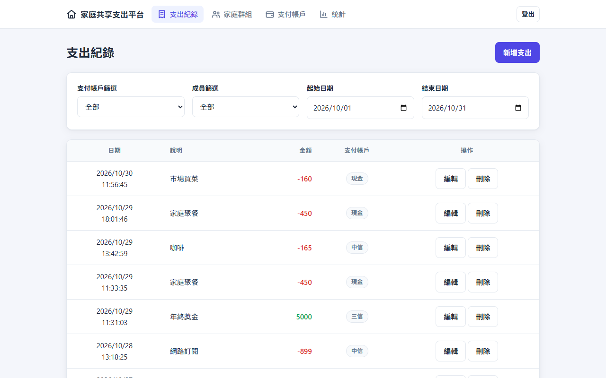
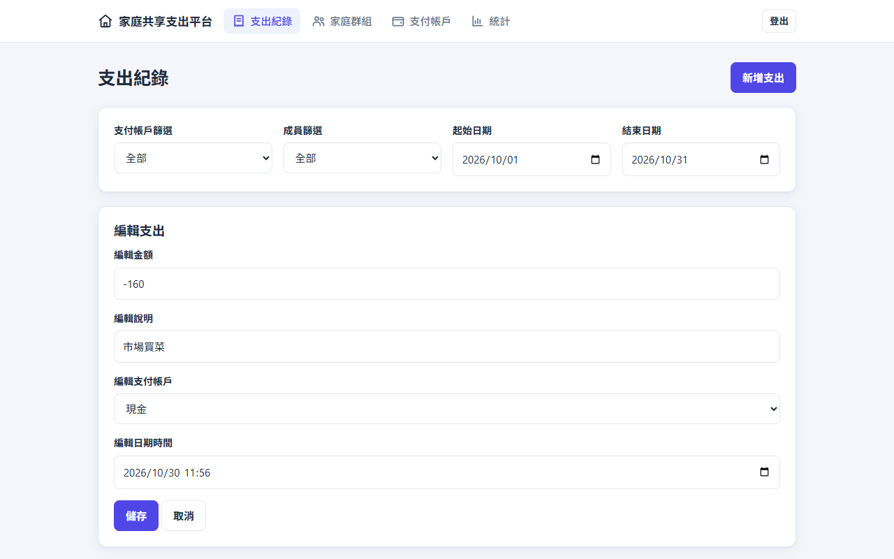
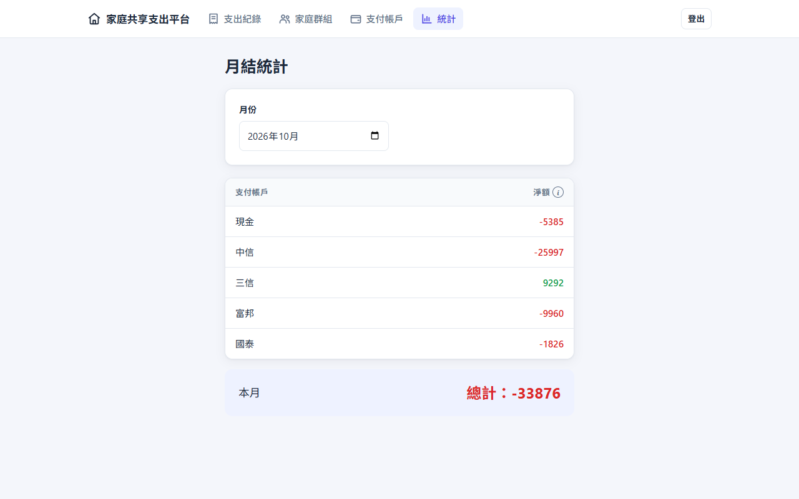
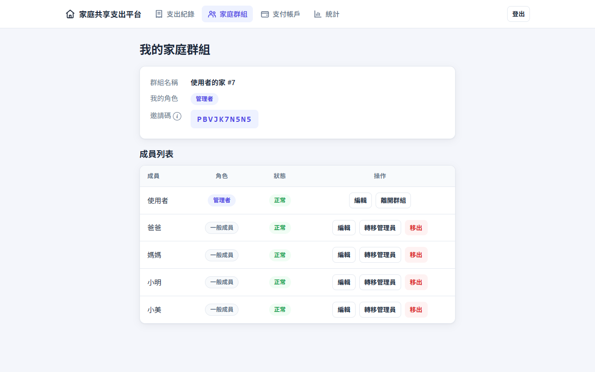
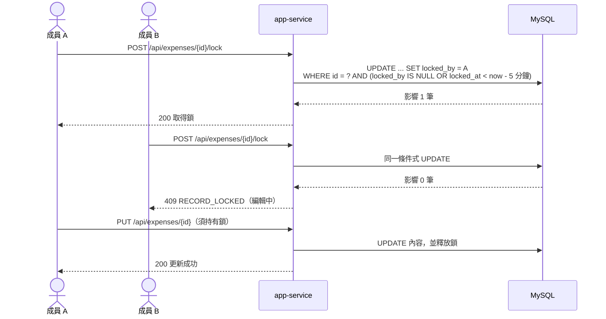
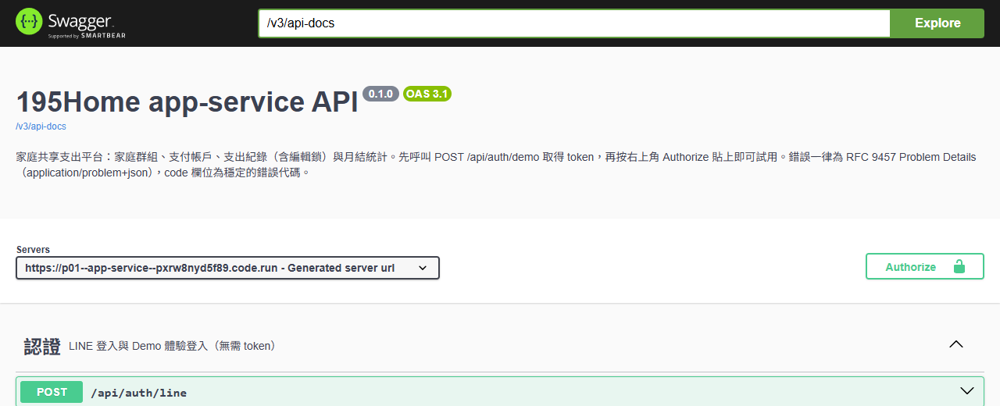

# 家庭共享支出平台（195Home）

家庭成員共同記帳、篩選查看、統計月結，並透過 LINE Bot 收到每月支出匯總或主動查詢。

**線上 Demo**：https://p01--app-service--pxrw8nyd5f89.code.run/ （登入頁點「Demo 體驗」即可，免帳號）
**API 文件**：https://p01--app-service--pxrw8nyd5f89.code.run/swagger-ui.html

## 畫面預覽

| 支出紀錄（篩選、分頁） | 編輯支出（先取得編輯鎖） |
|---|---|
|  |  |

| 月結統計 | 家庭群組與成員 |
|---|---|
|  |  |

## 系統架構

- **app-service**：LINE 登入、家庭群組、支付帳戶、支出紀錄、月結統計，並直接 serve 前端靜態檔案（同源部署，無需 CORS 與 Gateway）。內部依領域分 family / expense / statistics 模組。
- **notification-service**：LINE Bot Webhook、每月自動推播與關鍵字查詢；與 app-service 之間唯一透過內部 REST（`X-Internal-Token`）溝通。

## 關鍵流程：支出編輯鎖

多位家人可能同時編輯同一筆紀錄。編輯鎖以資料庫的**條件式 `UPDATE`** 實作（不需分散式鎖元件）：只有「未鎖定」或「鎖已逾時（5 分鐘）」時更新才會成功，同時搶鎖時有且只有一人取得。

## API 文件

內建 OpenAPI（springdoc），可直接在 [Swagger UI](https://p01--app-service--pxrw8nyd5f89.code.run/swagger-ui.html) 試用：先呼叫 `POST /api/auth/demo` 取得 token，再按 **Authorize** 貼上。

## 技術選型

| 項目 | 選擇 | 理由 |
|------|------|------|
| 後端 | Java 17 + Spring Boot 3.5 | 核心學習目標 |
| 資料庫存取 | MyBatis + Flyway | 顯式 SQL、可讀性優先，避免 JPA 隱性行為 |
| 身份驗證 | LINE 登入 + Spring Security + JWT | 無密碼，LINE userId 即帳號；無需獨立 Gateway |
| 服務間通訊 | 同步 REST（僅 notification → app-service） | 家庭規模不需訊息佇列 |
| 前端 | React 18 + TypeScript + Vite | 同源部署簡化設定 |
| API 錯誤格式 | RFC 9457 Problem Details | 前端以單一邏輯處理所有錯誤 |
| 部署 | GitHub Actions → GHCR → Northflank | CI 通過後自動部署 |

## 更多文件

- [開發、測試與部署](docs/DEVELOPMENT.md)
- [測試策略](TESTING.md)
- [規格與設計文件](specs/001-family-expense-tracking/)
