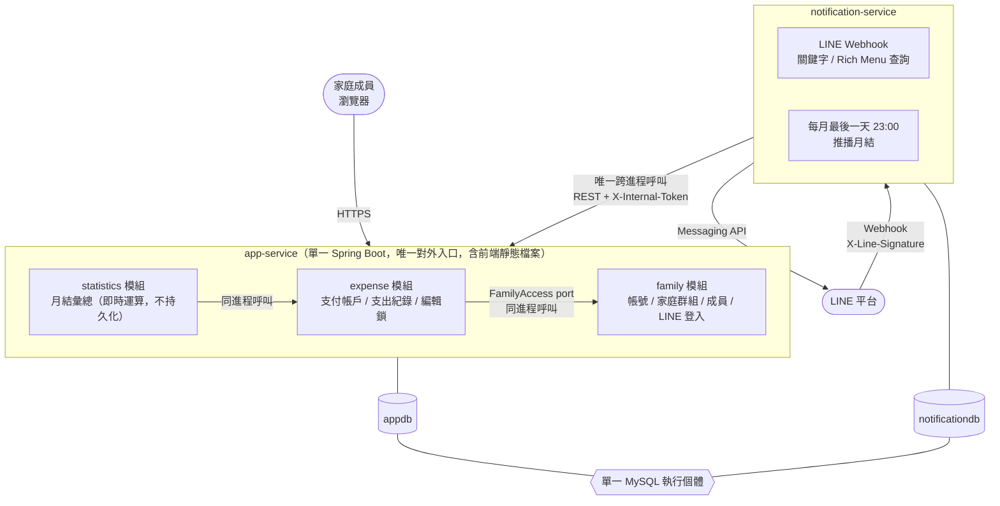
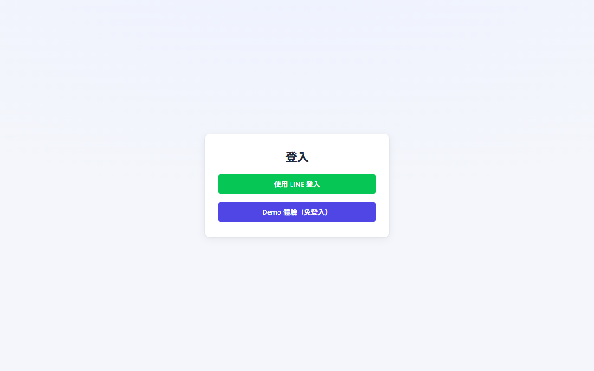
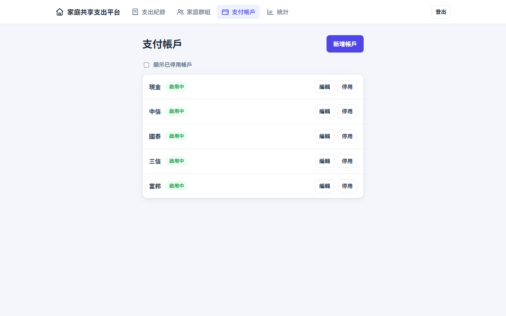
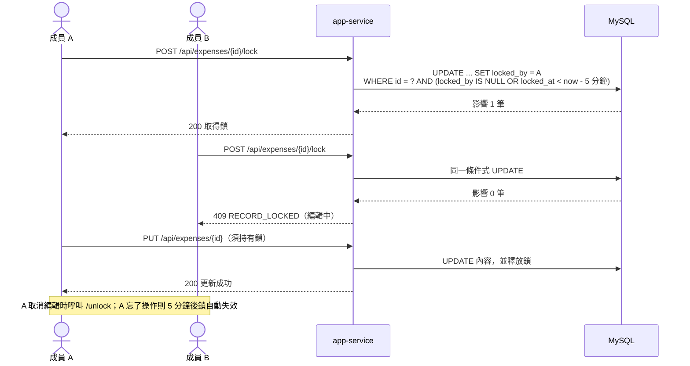
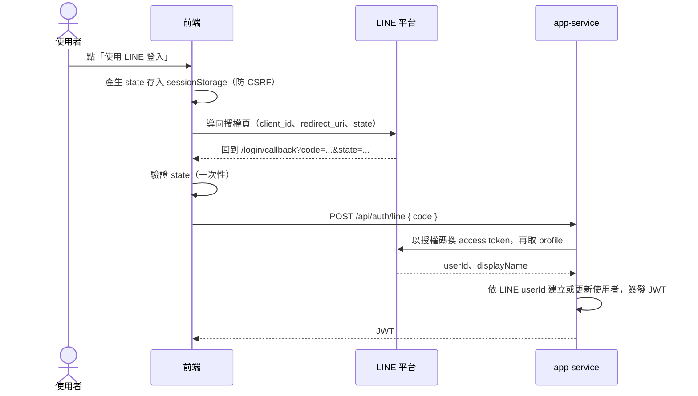
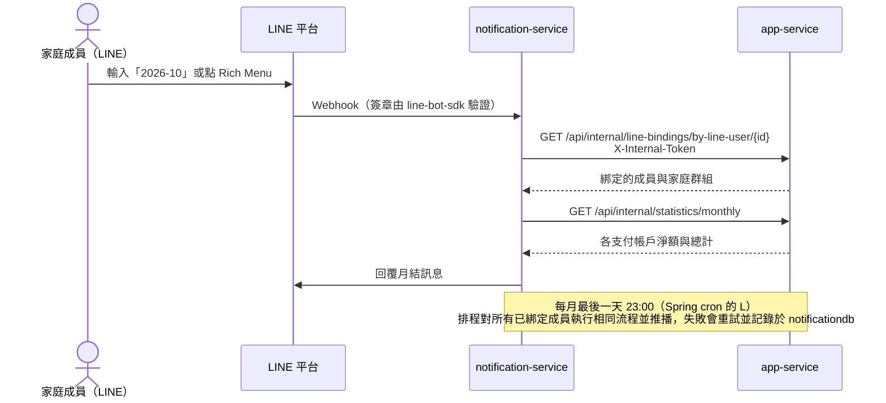

# 家庭共享支出平台（195Home）

家庭成員共同記帳、篩選查看、統計月結，並透過 LINE Bot 收到每月支出匯總或主動查詢。

## 系統架構



系統依 [constitution](.specify/memory/constitution.md) 採 **2 個部署服務**：

- **app-service**：LINE 身分登入、家庭群組、支付帳戶、支出紀錄、月結統計，並直接 serve 前端建置後的靜態檔案（同源部署，無需 CORS、無需獨立 Gateway）。內部依業務領域（family/expense/statistics）維持套件模組邊界。
- **notification-service**：LINE Bot Webhook、每月最後一天 23:00 自動推播、LINE 關鍵字查詢。與 app-service 之間唯一透過內部 REST API（`X-Internal-Token` 驗證）溝通。

完整規格與設計文件見 [`specs/001-family-expense-tracking/`](specs/001-family-expense-tracking/)（spec.md、plan.md、research.md、data-model.md、contracts/、tasks.md）。

## 畫面預覽

| 登入（LINE／Demo 體驗） | 支出紀錄（篩選、分頁） |
|---|---|
|  |  |

| 編輯支出（先取得編輯鎖） | 月結統計 |
|---|---|
|  |  |

| 家庭群組與成員 | 支付帳戶 |
|---|---|
|  |  |

## 關鍵流程

### 支出編輯鎖

多位家人可能同時編輯同一筆紀錄。編輯鎖以資料庫的**條件式 `UPDATE`** 實作（不需要額外的分散式鎖元件）：只有「未鎖定」或「鎖已逾時（5 分鐘）」時更新才會成功，因此同時搶鎖時有且只有一人取得。



### LINE 登入



### LINE Bot 月結查詢與每月推播



## API 文件

app-service 內建 OpenAPI（springdoc）：啟動後開啟 `/swagger-ui.html` 即可瀏覽與試用，規格在 `/v3/api-docs`。先呼叫 `POST /api/auth/demo` 取得 token，再按右上角 **Authorize** 貼上即可。內部 API（`/api/internal/**`）不列入文件。


## 技術選型

| 項目 | 選擇 | 理由 |
|------|------|------|
| 後端語言/框架 | Java 17 + Spring Boot 3.5 | constitution 核心學習目標 |
| 資料庫存取 | MyBatis + Flyway | 顯式 SQL、可讀性優先，避免 JPA 隱性行為 |
| 身份驗證 | LINE 身分登入 + Spring Security + JWT（jjwt） | 無密碼，LINE userId 即帳號；app-service 內建本地驗證，無需獨立 Gateway |
| 服務間通訊 | 同步 REST（僅 notification→app-service 一條） | 家庭規模不需訊息佇列 |
| 前端 | React 18 + TypeScript + Vite + ESLint | 已具備技術，同源部署簡化設定 |
| API 錯誤格式 | RFC 9457 Problem Details（`application/problem+json`） | Spring 6 內建標準，前端以單一邏輯處理所有錯誤；業務錯誤仍以 Exception 丟出，不使用 Result 型別 |
| 部署 | Northflank Sandbox 免費方案 | 2 個免費 service + 1 個免費 database，恰好對應 2 個部署服務的架構 |

### 為什麼不用 .NET？

專案的核心學習與展示目標是 Java/Spring Boot 生態系的深度；技術棧分散會稀釋展示重點，也不符合 constitution 原則 II 的技術棧一致性要求。

### 為什麼不用訊息佇列？

系統只有一條跨進程呼叫（notification-service → app-service），且屬單向、非高頻的查詢/推播情境，同步 REST 已足以呈現服務邊界與依賴管理；引入 Kafka/RabbitMQ 只會增加不必要的維運複雜度，與家庭規模的實際需求不成比例。

### 為什麼只拆兩個服務，不是完整微服務？

專案僅供家人自用、非高併發，且確定部署目標為 Northflank 免費 Sandbox 方案（2 個免費 service + 1 個免費 database）。在此規模下拆成多個進程屬於過度設計，違反 constitution 原則 VI（可讀性與可解釋性優先於炫技）。因此採 2 個部署服務、以套件層級模組化（family/expense/statistics）維持服務邊界，可清楚展示服務邊界設計能力與「何時該拆、何時不該拆」的架構判斷，且完全落在免費方案額度內。

## 本機開發

前置需求：Docker / Docker Compose、JDK 17、Node.js。

### 方式一：只用 Docker 跑 MySQL，前後端在本機執行（日常開發建議）

```bash
# 1. 只啟動 MySQL（對外 port 為 3307，會自動建立 appdb 與 notificationdb）
docker compose up -d mysql

# 2. 啟動 app-service（http://localhost:8080）
cd app-service
SPRING_PROFILES_ACTIVE=dev ./mvnw spring-boot:run

# 3. （需要 LINE 功能時）啟動 notification-service（http://localhost:8081）
cd notification-service
SPRING_PROFILES_ACTIVE=dev ./mvnw spring-boot:run

# 4. 啟動前端（http://localhost:5173，/api 會 proxy 到 localhost:8080）
cd frontend && npm install && npm run dev
```

> **登入方式**：兩種並行，無帳號密碼。
> - **Demo 體驗**：登入頁的「Demo 體驗（免登入）」按鈕，後端 `POST /api/auth/demo` 一鍵建立隨機帳號（顯示名稱「使用者」，每次都是全新帳號、互不干擾），並自動建立家庭群組（登入者為管理者，另有爸爸、媽媽、小明、小美 4 位示範成員）、5 個支付帳戶（現金、中信、國泰、三信、富邦）與範例支出（隨機分配給各成員，從上個月 1 日到今天，每天隨機 0–5 筆，通常超過一頁可看到分頁），登入即有內容可看（見 `DemoLoginService`）。由環境變數 `DEMO_LOGIN_ENABLED` 控制（dev profile 預設開啟，其他環境預設關閉），前端透過 `GET /api/auth/config` 決定是否顯示按鈕。Demo 帳號沒有真實 LINE ID，月結推播會自動略過。展示環境請勿放入真實資料。公開環境另有保護：`POST /api/auth/demo` 每小時限流（每 IP 20 次、全站 300 次，`app.demo-login.max-per-client-per-hour` / `max-total-per-hour`），並每小時清除超過 24 小時（`retention-hours`）的 Demo 群組、支出與帳號（`DemoDataCleanupScheduler`，僅在啟用 Demo 登入時執行）。
> - **LINE 登入**：前端建置時設定 `VITE_LINE_CHANNEL_ID` 才會顯示「使用 LINE 登入」按鈕，導向 LINE 授權頁，回到 `/login/callback` 後以授權碼呼叫 `POST /api/auth/line`，後端由 `LineOAuthLoginClient` 換取 profile；後端需 `LINE_LOGIN_CHANNEL_ID`／`LINE_LOGIN_CHANNEL_SECRET`／`LINE_LOGIN_REDIRECT_URI`（prod 缺少即啟動失敗）。本機 Docker：複製 `line.env.example` 為 `.env` 並填入 LINE 憑證，再 `docker compose up -d --build`（同一個 `docker-compose.yml`，未填則只有 Demo 按鈕）；不用 Docker 時可在 `frontend/.env.local` 設定 `VITE_LINE_CHANNEL_ID` 並於 LINE Developers Console 登錄 `http://localhost:5173/login/callback`。

說明：

- `application-dev.yml` 的連線預設為 `localhost:3307`（對應 Docker MySQL），帳號密碼、`JWT_SECRET`、`INTERNAL_TOKEN` 皆有 dev 預設值，不需額外設定。
- Windows PowerShell 請改用 `$env:SPRING_PROFILES_ACTIVE="dev"; ./mvnw spring-boot:run`。
- 前端由 Vite dev server 提供 HMR；後端程式碼修改後需重啟（或加入 `spring-boot-devtools` 自動重啟）。

#### 使用 VS Code Tasks 一鍵啟動

[`.vscode/tasks.json`](.vscode/tasks.json) 已包含上述指令（`Ctrl+Shift+P` → `Tasks: Run Task`）：

| Task | 說明 |
|------|------|
| `dev: 啟動 MySQL + 前後端` | 先啟動並等待 MySQL healthy，再同時啟動 app-service 與前端（預設 build task，可直接按 `Ctrl+Shift+B`） |
| `mysql: up` | 只啟動 MySQL |
| `app-service: run (dev profile)` | 單獨啟動 app-service |
| `notification-service: run (dev profile)` | 單獨啟動 notification-service（需要 LINE 功能時才跑） |
| `frontend: dev` | 單獨啟動前端 |

注意：若 Docker 內的 `app-service` / `notification-service` 容器仍在執行，會佔用 8080 / 8081，需先 `docker compose stop app-service notification-service`。

#### 本機機密與覆蓋設定（類似 .NET user-secrets）

`dev` profile 會自動載入使用者目錄下**選用**的設定檔（不存在也不會報錯），內容優先於 `application-dev.yml` 的預設值。檔案位於 repo 之外，不會進版控：

| 服務 | 檔案位置 |
|------|----------|
| app-service | `~/.195home/app-service.yml`（Windows：`C:\Users\<使用者>\.195home\app-service.yml`） |
| notification-service | `~/.195home/notification-service.yml` |

範例（`notification-service.yml`，填入真實的 LINE 憑證）：

```yaml
line:
  bot:
    channel-token: <你的 LINE channel token>
    channel-secret: <你的 LINE channel secret>
```

範例（`app-service.yml`，覆蓋 JWT 密鑰）：

```yaml
app:
  jwt:
    secret: <至少 32 bytes 的自訂字串>
```

### 方式二：全部以 Docker 執行（驗證完整部署）

```bash
docker compose up -d --build
```

docker-compose 以 `SPRING_PROFILES_ACTIVE=dev` 啟動（使用開發用預設機密）；正式環境 profile 為 `prod`，所有機密須由環境變數提供，缺少時應用程式啟動失敗。

啟動後：
- 網頁與 API 入口：http://localhost:8080
- app-service 健康檢查：http://localhost:8080/actuator/health
- notification-service：於 docker-compose 網路內部運作；若要實測 LINE Webhook，需另外用 ngrok 等工具將 8081 對外轉發並設定 LINE Developers Console 的 Webhook URL

停止與清除：

```bash
docker compose down -v
```

## 執行測試

```bash
# app-service / notification-service（於各自服務目錄下，使用 Maven Wrapper）
./mvnw -B test

# 前端
cd frontend && npm ci && npm run lint && npm test
```

整合測試使用 Testcontainers，需要 Docker；測試分類、profile 與 Migration 規則見 [TESTING.md](TESTING.md)。
手動測試 API 可使用 [`app-service/http/app-service.http`](app-service/http/app-service.http)（VS Code REST Client）。

## 部署到 Northflank

1. 於 Northflank 建立專案，開通 1 個免費 MySQL database，建立 `appdb`、`notificationdb` 兩個 schema
2. 建立 2 個 Northflank service：`app-service`、`notification-service`，各自設定對應的映像檔來源（GHCR）
3. 設定各服務所需環境變數：資料庫連線資訊、`JWT_SECRET`、`INTERNAL_TOKEN`、LINE Login 的 `LINE_LOGIN_CHANNEL_ID`、`LINE_LOGIN_CHANNEL_SECRET`、`LINE_LOGIN_REDIRECT_URI`（須為 `<網站網址>/login/callback`，並登錄於 LINE Developers Console 的 Callback URL）、`DEMO_LOGIN_ENABLED=true`（要開放 Demo 體驗時）、`LINE_CHANNEL_TOKEN`、`LINE_CHANNEL_SECRET`、`APP_SERVICE_BASE_URL`（notification-service 指向 app-service 的 Northflank 內部網域）
4. 於 GitHub repo 設定 Actions variable `LINE_LOGIN_CHANNEL_ID`（公開資訊，建置前端時內嵌為 `VITE_LINE_CHANNEL_ID`）。`.github/workflows/cd.yml` 於 `master` 分支的 CI 成功後（workflow_run）建置映像檔（`latest` 與 `sha-<commit>` tag）、推送至 GHCR，並觸發 Northflank 兩個 service 重新部署（實際觸發方式請對照 Northflank API/CLI 文件核實）

詳見 [quickstart.md](specs/001-family-expense-tracking/quickstart.md)。

## 已知限制與取捨

- **併發的「先查後寫」**：加入／建立群組、群組名稱與邀請碼都是先查再寫，併發時可能漏過檢查；資料庫的唯一約束會兜底，並由 `GlobalExceptionHandler` 把 `DuplicateKeyException` 轉成 409。尚未對「每位使用者同時只能有一個在職成員身分」建立資料庫層約束。
- **編輯鎖為樂觀機制**：以條件式 `UPDATE` 取得鎖（5 分鐘 TTL），不使用分散式鎖；適合單一資料庫的家庭規模，無法防止鎖逾時後的覆寫。
- **分頁使用 `OFFSET`**：家庭資料量下足夠，資料量大時應改用 keyset 分頁。
- **Demo 限流為記憶體計數**：重啟會歸零、多實例不共用，目前單一實例已足夠。
- **Token 存在 `localStorage`**：容易受 XSS 影響，但改用 HttpOnly Cookie 需另行處理 CSRF，對此規模屬過度設計。
- **程式碼格式**：後端以 spotless 檢查未使用 import、行尾空白與結尾換行（`./mvnw spotless:apply` 可自動修正），不強制 google-java-format 以維持既有風格。

## 目錄結構

```text
app-service/            # family + expense + statistics 模組 + 前端靜態檔案
notification-service/   # LINE Bot 整合
frontend/               # React + TypeScript 前端原始碼
docker-compose.yml      # 本機一鍵啟動
.github/workflows/      # CI（build+test+lint）、CD（部署至 Northflank）
.vscode/                # 共用的 tasks.json、推薦擴充套件
specs/                  # spec-kit 規格與設計文件
TESTING.md              # 測試分類、執行方式、profile 與 Migration 規則
```

### 後端套件結構

兩個後端服務採相同的分層慣例：

```text
<module>/
├── application/            # Service（用例）+ Repository 介面（port）
├── domain/                 # 純 POJO 資料模型，不依賴框架
├── infrastructure/         # persistence（Mapper + RepositoryImpl）、client、line、security 等外部 adapter
└── presentation/           # Controller + dto（Request/Response）
shared/                     # 跨模組共用（例外、分頁、身分）
config/                     # Spring 設定類別
```

依賴方向：presentation → application → domain；infrastructure 實作 application 定義的 port（Repository、`TokenIssuer`），application 不直接依賴 infrastructure。

app-service 依業務領域（family / expense / statistics）分模組，模組內再依上述分層；statistics 無持久化，因此沒有 infrastructure。測試目錄鏡像 main 的套件結構。
