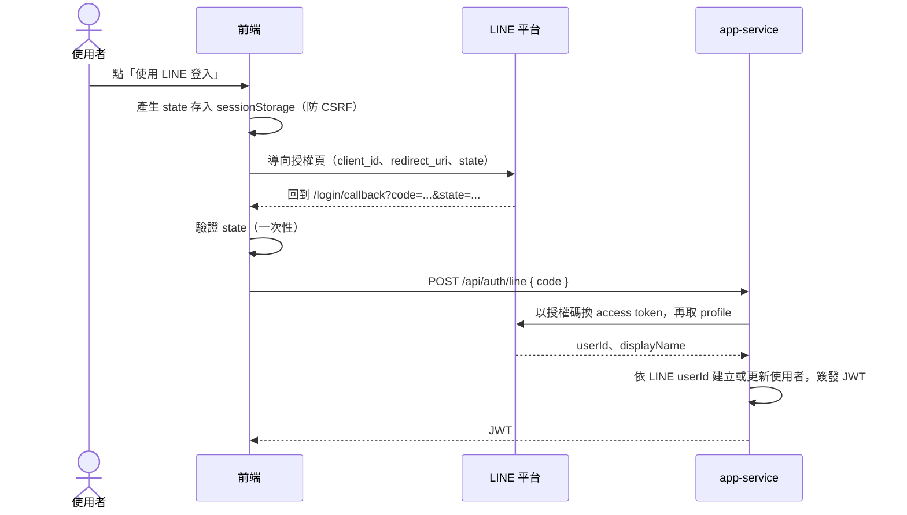
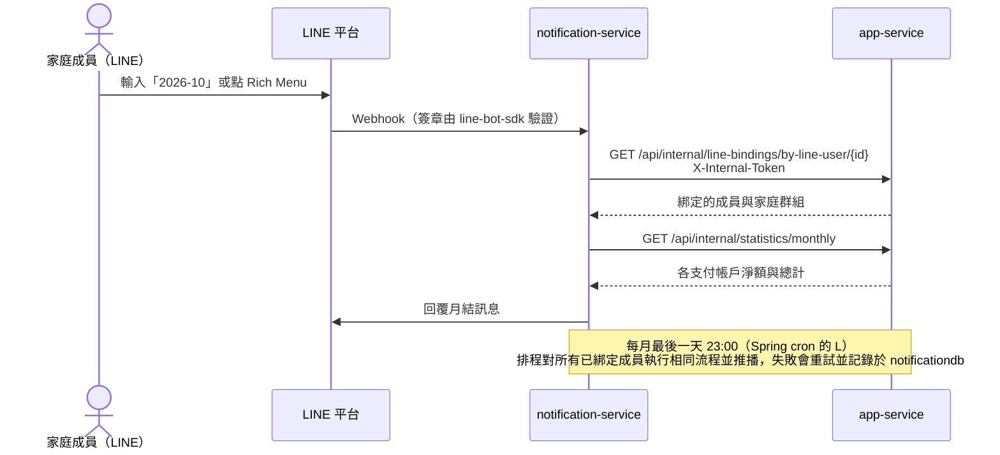

# 開發、測試與部署

## 登入方式

兩種並行，無帳號密碼。

- **Demo 體驗**：登入頁的「Demo 體驗（免登入）」按鈕，後端 `POST /api/auth/demo` 一鍵建立隨機帳號，並自動建立家庭群組（登入者為管理者，另有爸爸、媽媽、小明、小美 4 位示範成員）、5 個支付帳戶與範例支出（見 `DemoLoginService`）。由環境變數 `DEMO_LOGIN_ENABLED` 控制（dev profile 預設開啟，其他環境預設關閉），前端透過 `GET /api/auth/config` 決定是否顯示按鈕。Demo 帳號沒有真實 LINE ID，月結推播會自動略過。展示環境請勿放入真實資料。公開環境另有保護：`POST /api/auth/demo` 每小時限流（每 IP 20 次、全站 300 次，`app.demo-login.max-per-client-per-hour` / `max-total-per-hour`），並每小時清除超過 24 小時（`retention-hours`）的 Demo 資料（`DemoDataCleanupScheduler`）。
- **LINE 登入**：前端建置時設定 `VITE_LINE_CHANNEL_ID` 才會顯示「使用 LINE 登入」按鈕，導向 LINE 授權頁，回到 `/login/callback` 後以授權碼呼叫 `POST /api/auth/line`，後端由 `LineOAuthLoginClient` 換取 profile；後端需 `LINE_LOGIN_CHANNEL_ID`／`LINE_LOGIN_CHANNEL_SECRET`／`LINE_LOGIN_REDIRECT_URI`（prod 缺少即啟動失敗）。本機 Docker：複製 `.env.example` 為 `.env` 並填入 LINE 憑證，再 `docker compose up -d --build`；不用 Docker 時可在 `frontend/.env.local` 設定 `VITE_LINE_CHANNEL_ID` 並於 LINE Developers Console 登錄 `http://localhost:5173/login/callback`。

### LINE 登入流程



### LINE Bot 月結查詢與每月推播



## 本機開發

前置需求：Docker / Docker Compose、JDK 17、Node.js。

### 方式一：只用 Docker 跑 MySQL，前後端在本機執行（日常開發建議）

```bash
# 1. 只啟動 MySQL（對外 port 為 3307，會自動建立 appdb 與 notificationdb）
docker compose up -d mysql

# 2. 啟動 app-service（http://localhost:8080）
cd app-service
SPRING_PROFILES_ACTIVE=dev ./mvnw spring-boot:run

# 3. （需要 LINE 功能時）啟動 notification-service（http://localhost:8081）
cd notification-service
SPRING_PROFILES_ACTIVE=dev ./mvnw spring-boot:run

# 4. 啟動前端（http://localhost:5173，/api 會 proxy 到 localhost:8080）
cd frontend && npm install && npm run dev
```

- `application-dev.yml` 的連線預設為 `localhost:3307`（對應 Docker MySQL），帳號密碼、`JWT_SECRET`、`INTERNAL_TOKEN` 皆有 dev 預設值，不需額外設定。
- Windows PowerShell 請改用 `$env:SPRING_PROFILES_ACTIVE="dev"; ./mvnw spring-boot:run`。
- 後端程式碼修改後需重啟；前端由 Vite dev server 提供 HMR。

#### VS Code Tasks

[`.vscode/tasks.json`](../.vscode/tasks.json) 已包含上述指令（`Ctrl+Shift+P` → `Tasks: Run Task`）：

| Task | 說明 |
|------|------|
| `dev: 啟動 MySQL + 前後端` | 先啟動並等待 MySQL healthy，再同時啟動 app-service 與前端（預設 build task，`Ctrl+Shift+B`） |
| `mysql: up` | 只啟動 MySQL |
| `app-service: run (dev profile)` | 單獨啟動 app-service |
| `notification-service: run (dev profile)` | 單獨啟動 notification-service |
| `frontend: dev` | 單獨啟動前端 |

若 Docker 內的 `app-service` / `notification-service` 容器仍在執行，會佔用 8080 / 8081，需先 `docker compose stop app-service notification-service`。

#### 本機機密與覆蓋設定

`dev` profile 會自動載入使用者目錄下**選用**的設定檔（不存在也不會報錯），內容優先於 `application-dev.yml`，檔案位於 repo 之外，不會進版控：

| 服務 | 檔案位置 |
|------|----------|
| app-service | `~/.195home/app-service.yml`（Windows：`C:\Users\<使用者>\.195home\app-service.yml`） |
| notification-service | `~/.195home/notification-service.yml` |

```yaml
# notification-service.yml
line:
  bot:
    channel-token: <你的 LINE channel token>
    channel-secret: <你的 LINE channel secret>
```

```yaml
# app-service.yml
app:
  jwt:
    secret: <至少 32 bytes 的自訂字串>
```

### 方式二：全部以 Docker 執行（驗證完整部署）

```bash
docker compose up -d --build
docker compose down -v   # 停止與清除
```

docker-compose 以 `SPRING_PROFILES_ACTIVE=dev` 啟動；正式環境 profile 為 `prod`，所有機密須由環境變數提供，缺少時應用程式啟動失敗。

- 網頁與 API 入口：http://localhost:8080
- 健康檢查：http://localhost:8080/actuator/health
- notification-service 於 docker-compose 網路內部運作；若要實測 LINE Webhook，需另用 ngrok 等工具將 8081 對外轉發並設定 LINE Developers Console 的 Webhook URL。

## 執行測試

```bash
# app-service / notification-service（於各自服務目錄下）
./mvnw -B test

# 前端
cd frontend && npm ci && npm run lint && npm test
```

整合測試使用 Testcontainers，需要 Docker；測試分類、profile 與 Migration 規則見 [TESTING.md](../TESTING.md)。
手動測試 API 可使用 [`app-service/http/app-service.http`](../app-service/http/app-service.http)（VS Code REST Client）。

## 部署到 Northflank

1. 於 Northflank 建立專案，開通 1 個免費 MySQL database，建立 `appdb`、`notificationdb` 兩個 schema
2. 建立 2 個 service：`app-service`、`notification-service`，各自設定對應的映像檔來源（GHCR）
3. 設定各服務所需環境變數：資料庫連線資訊、`JWT_SECRET`、`INTERNAL_TOKEN`、`LINE_LOGIN_CHANNEL_ID`、`LINE_LOGIN_CHANNEL_SECRET`、`LINE_LOGIN_REDIRECT_URI`（須為 `<網站網址>/login/callback`，並登錄於 LINE Developers Console）、`DEMO_LOGIN_ENABLED=true`（開放 Demo 體驗時）、`LINE_CHANNEL_TOKEN`、`LINE_CHANNEL_SECRET`、`APP_SERVICE_BASE_URL`（notification-service 指向 app-service 的內部網域）
4. 於 GitHub repo 設定 Actions variable `LINE_LOGIN_CHANNEL_ID`（建置前端時內嵌為 `VITE_LINE_CHANNEL_ID`）。`.github/workflows/cd.yml` 於 `main` 分支的 CI 成功後（`workflow_run`）建置映像檔（`latest` 與 `sha-<commit>` tag）、推送至 GHCR，並以 `sha-<commit>` tag 透過 `northflank/deploy-to-northflank` 部署兩個 service（需設定 Actions variable `NORTHFLANK_CREDENTIALS_ID`）

詳見 [quickstart.md](../specs/001-family-expense-tracking/quickstart.md)。

## 目錄結構

```text
app-service/            # family + expense + statistics 模組 + 前端靜態檔案
notification-service/   # LINE Bot 整合
frontend/               # React + TypeScript 前端原始碼
docker-compose.yml      # 本機一鍵啟動
.github/workflows/      # CI（build+test+lint）、CD（部署至 Northflank）
.vscode/                # 共用的 tasks.json、推薦擴充套件
specs/                  # spec-kit 規格與設計文件
TESTING.md              # 測試分類、執行方式、profile 與 Migration 規則
```

### 後端套件結構

兩個後端服務採相同的分層慣例：

```text
<module>/
├── application/            # Service（用例）+ Repository 介面（port）
├── domain/                 # 純 POJO 資料模型，不依賴框架
├── infrastructure/         # persistence（Mapper + RepositoryImpl）、client、line、security 等外部 adapter
└── presentation/           # Controller + dto（Request/Response）
shared/                     # 跨模組共用（例外、分頁、身分）
config/                     # Spring 設定類別
```

依賴方向：presentation → application → domain；infrastructure 實作 application 定義的 port，application 不直接依賴 infrastructure。app-service 依業務領域分模組，模組內再依上述分層；statistics 無持久化，因此沒有 infrastructure。
